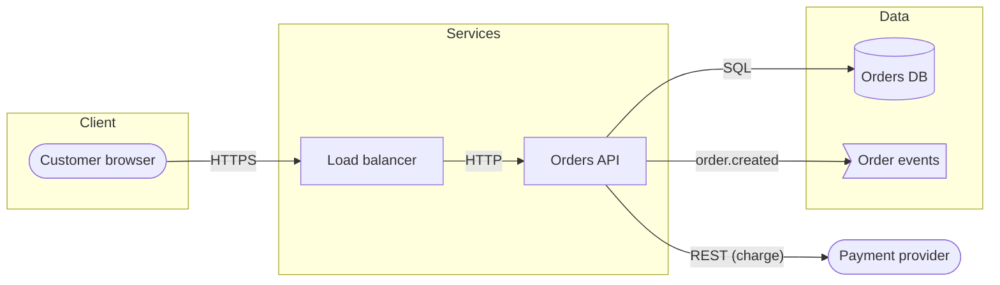
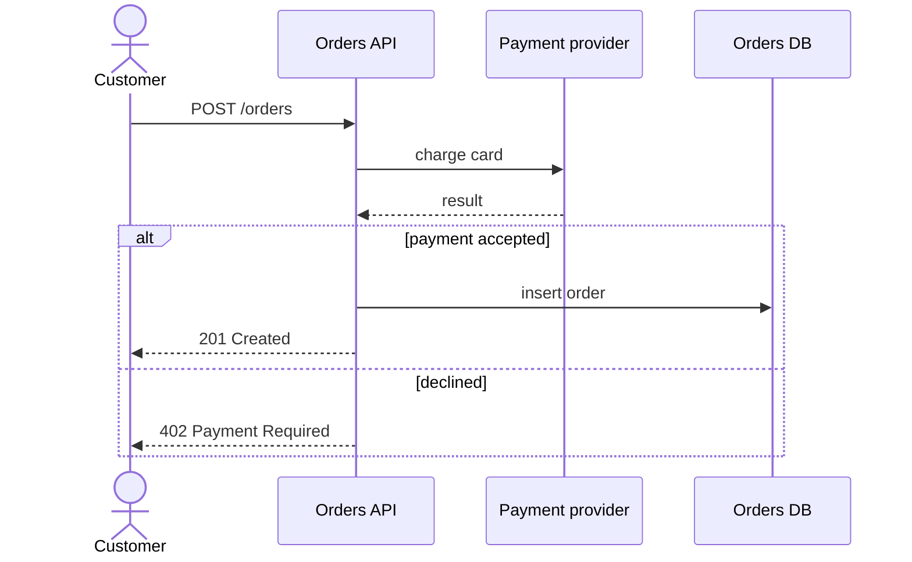
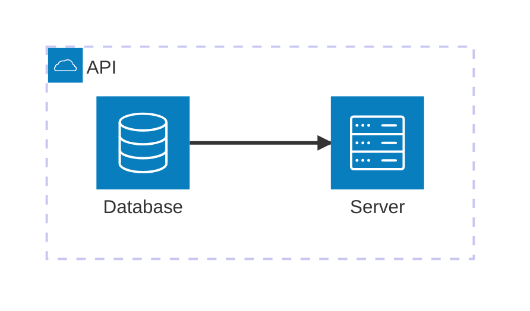

# Shapes and Examples

Component→shape vocabulary, two portable examples, and the optional renderer-dependent tier.

## Component Shapes

| Component                                      | Shape           | Syntax              |
| ---------------------------------------------- | --------------- | ------------------- |
| Service, API, worker, function, load balancer  | rectangle       | `api["Orders API"]` |
| Database, cache, object store                  | cylinder        | `db[("Orders DB")]` |
| Queue, topic, event stream                     | asymmetric flag | `q>"Order events"]` |
| External system, third party, person or client | pill (stadium)  | `pay(["Stripe"])`   |
| Decision — a yes/no or multi-way branch only   | diamond         | `ok{"Paid?"}`       |

Anything not listed is a rectangle. Pick one shape per component type and keep it across every diagram in the doc.

## Infra Example

Tiers run left to right, so the sibling subgraphs are declared right to left.

## Sequence Example

## Optional Tier

Use only when Tom asks.

- Name the Mermaid version the viewer needs.
- VSCode's built-in preview bundles Mermaid 11.17, so all of these work there.
- Check GitHub before relying on them; Mermaid 10.x fails to parse named shapes and `architecture-beta`.

Features:

- **Named shapes** (Mermaid 11.3.0+) — `id@{ shape: <name>, label: "…" }` gives shapes the classic syntax lacks:
  - `h-cyl` — horizontal cylinder, a closer fit for queues and streams.
  - `doc` — document.
  - `lin-cyl` — lined cylinder for disk or stored data.
  - Example: `events@{ shape: h-cyl, label: "Order events" }`.
- **Font Awesome icons in labels** — `B[fa:fa-database Orders DB]`.
  - Render only where the viewer loads Font Awesome CSS or registers an icon pack (11.7.0+).
  - Elsewhere the label shows without its icon.
- **Icon shape** (Mermaid 11.3.0+) — `id@{ icon: "…", label: "…" }`.
  - Always needs a registered icon pack.
- **`architecture-beta`** (Mermaid 11.1.0+) — groups, services and edges with icons and side-anchored links, as below.
  - Built-in icons: `cloud`, `database`, `disk`, `internet`, `server`.
  - Other icons need an icon pack the viewer has registered.

